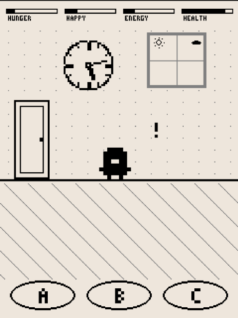

# PseudoPet — Sailfish OS Port

[SFOS port] This repository is a **Sailfish OS (SFOS) port** of the retro
Android virtual pet game **PseudoPet**. The original game lives at
<https://github.com/Zahnschmelz/pseudoPet> — this repo only adds the
platform layer (packaging, fullscreen adaptation, touch input, systemd
keeper) on top of the original pygame/SDL2 game.

## Screenshots

Phone screenshot (Jolla 2026, 1032×2272):



## Building

See **[BUILD.md](BUILD.md)** — sfdk-based RPM build incl. the offline
dependency sources shipped in `rpm/`.

For an in-depth explanation of the platform layer (fullscreen geometry,
canvas model, desktop file quirks, SDL2/system setup on device, common
pitfalls) see **[README_TECHNICAL.md](README_TECHNICAL.md)**.

## Testing without a phone

```bash
cd src
SDL_VIDEODRIVER=dummy SDL_AUDIODRIVER=dummy python3 main.py
```

## Relationship to the original

| | Original | This port |
|---|---|---|
| Target | Android (Kivy/APK) | Sailfish OS (SDL2/pygame, RPM) |
| Game code | — | identical game logic, minimally patched with `[SFOS-PORT]` markers |
| Packaging | APK | `harbour-pseudopet` RPM + systemd user timer |

All gameplay source carries the original license (see `src/LICENSE`);
porting additions are provided under the same terms.
