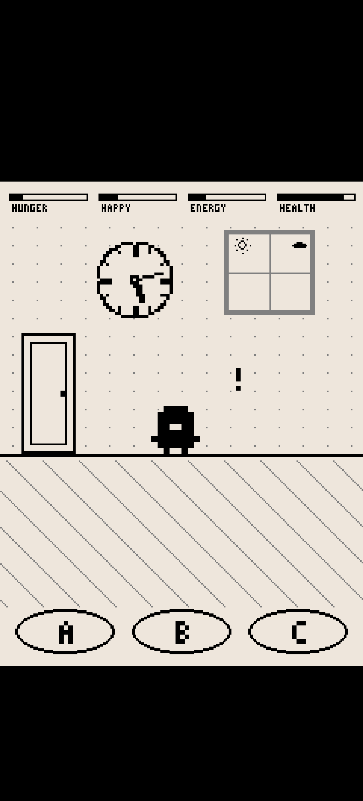

# PseudoPet — Sailfish OS Port

[SFOS port] This repository is a **Sailfish OS (SFOS) port** of the retro
Android virtual pet game **PseudoPet**. The original game lives at
<https://github.com/Zahnschmelz/pseudoPet> — this repo only adds the
platform layer (packaging, fullscreen adaptation, touch input, systemd
keeper) on top of the original pygame/SDL2 game.

## Screenshots

Phone screenshot (Jolla, 1032×2272): black letterbox bars like the
Android original, game world in the 240×320 design window, flat A/B/C
buttons at the bottom.



## Features

- Faithful 240×320 monochrome LCD look, scaled pixel-perfect
- Fullscreen on tall phone panels (Weston/Lipstick) with black
  letterbox bars — content never bleeds into the system UI area
- A/B/C drawn touch buttons; touch zones derived from the same layout
  source, holds repeat (letter grid, fishing lift, …)
- All original mini-games (fishing, pong, defense, snack, …), day/night
  world, evolution, offline simulation
- Background keeper (systemd user timer): hatch/evolution/death
  notifications while the app is closed (bypasses Silo mode)
- RPM for aarch64 (`RPMS/harbour-pseudopet-0.85-1.aarch64.rpm`)
- Game UI auto-detects system language (German/English)

## Installation (phone)

Requires Sailfish OS ≥ 5.x on aarch64.

```bash
scp RPMS/harbour-pseudopet-0.85-1.aarch64.rpm defaultuser@PHONE:/tmp/
# on the phone, as root:
rpm -Uvh --replacepkgs --nodeps /tmp/harbour-pseudopet-0.85-1.aarch64.rpm
```

Then launch “PseudoPet” from the application grid.

## Building

See **[BUILD.md](BUILD.md)** — sfdk-based RPM build incl. the offline
dependency sources shipped in `rpm/`.

For an in-depth explanation of the platform layer (fullscreen geometry,
canvas model, desktop file quirks, SDL2/system setup on device, common
pitfalls) see **[README_TECHNICAL.md](README_TECHNICAL.md)**.

## Testing without a phone

```bash
cd src
SDL_VIDEODRIVER=dummy SDL_AUDIODRIVER=dummy python3 main.py
```

Desktop mode renders the plain 240×320 design (no letterbox band).

## Relationship to the original

| | Original | This port |
|---|---|---|
| Target | Android (Kivy/APK) | Sailfish OS (SDL2/pygame, RPM) |
| Game code | — | identical game logic, minimally patched with `[SFOS-PORT]` markers |
| Packaging | APK | `harbour-pseudopet` RPM + systemd user timer |

All gameplay source carries the original license (see `src/LICENSE`);
porting additions are provided under the same terms.
